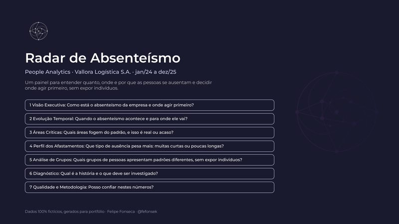

::: {.hero .container-lg}
# Felipe Fonseca

[[Statistician ·]{.titulo-parte} [data that drives decisions]{.titulo-parte}]{.hero-titulo}

[I help companies grow with better processes and reliable numbers, and I teach managers to do the same.]{.hero-frase}

::: botoes
[Let's talk](https://wa.me/5537984129390?text=Hi+Felipe+I+found+your+website+and+want+to+talk+about+my+business+numbers){.btn .btn-primary}
[About the mentoring](#mentoria){.btn .btn-outline-primary}
:::
:::

::: {.secao .container-lg}
## About

I'm a statistician (UFOP) and a master's student in Business Administration at IFMG. I have more than five years of industry experience in technology, management and sales, and I worked as a data analyst building Power BI dashboards and organizing management KPIs. Today I help companies anywhere, in person or remotely, turn scattered processes and spreadsheets into reliable numbers, and reliable numbers into better decisions.
:::

::: {.secao .container-lg}
## How I can help

::: {.grade .grade-ofertas}
::: {.cartao .cartao-oferta}
### Custom projects

[I do it with you.]{.cartao-lema}

Diagnosis, data organization, KPIs, Power BI dashboards, and payment and benefits audits. For those who need results fast and don't have the time or the team to do it alone.

[Book a 30-min call](https://wa.me/5537984129390?text=Hi+Felipe+I+want+to+book+a+30+minute+call){.btn .btn-primary}
:::

::: {.cartao .cartao-oferta #mentoria}
[Waitlist]{.etiqueta}

### Group mentoring

[I teach you to solve it.]{.cartao-lema}

Group sessions for managers and business owners who want to understand their own numbers, build their KPIs and make decisions with more confidence. The first cohort is now forming.

[Join the waitlist](https://wa.me/5537984129390?text=Hi+Felipe+I+want+to+know+about+the+next+mentoring+cohort){.btn .btn-primary}
:::
:::

[See all services](services.qmd){.mais}
:::

::: {.secao .container-lg}
## Featured project

::: destaque-projeto
[{fig-alt="Cover of the Absenteeism Radar dashboard"}](projects/absenteeism-radar/index.qmd)

::: {}
[Project · Power BI]{.etiqueta}

### Absenteeism Radar

A company's absenteeism rate stayed at 3.77% for two years in a row, and leadership concluded the issue was under control. This Power BI dashboard shows that the stability was just arithmetic: a sharp rise in two night-shift teams was being masked by improvements elsewhere.

Fictional company and data; real method, modeling and analysis.

[See the project](projects/absenteeism-radar/index.qmd){.btn .btn-primary}
:::
:::
:::
