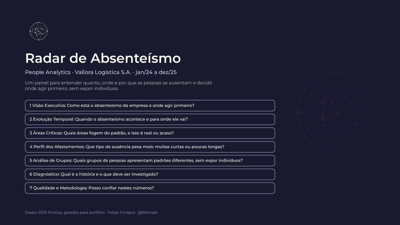

::: {.hero .container-lg}
# Orbita Space

[por Felipe Fonseca · Consultor de Datos | Estadística y BI]{.hero-titulo}

[Ayudo a empresas e investigadores a pasar de una hoja de cálculo con números sueltos a una respuesta clara: un tablero que muestra dónde actuar, un análisis que resiste la revisión de un jurado, un indicador que todos calculan de la misma manera, un informe que responde a una pregunta concreta.]{.hero-frase}

::: botoes
[Ver proyectos](proyectos.qmd){.btn .btn-primary}
[Escríbeme](contacto.qmd){.btn .btn-outline-primary}
:::
:::

::: {.secao .container-lg}
## Proyecto destacado

::: destaque-projeto
[{fig-alt="Portada del tablero Radar de Ausentismo"}](proyectos/radar-ausentismo/index.qmd)

::: {}
[Proyecto · Power BI]{.etiqueta}

### Radar de Ausentismo

La tasa de ausentismo de una empresa se mantuvo en 3,77% durante dos años, y la dirección concluyó que el tema estaba bajo control. Este tablero en Power BI muestra que esa estabilidad era solo aritmética: un empeoramiento concentrado en dos equipos del turno nocturno quedaba oculto por mejoras en otros frentes.

Empresa y datos ficticios; método, modelado y análisis reales.

[Ver el proyecto](proyectos/radar-ausentismo/index.qmd){.btn .btn-primary}
:::
:::
:::

::: {.secao .container-lg}
## Lo que hago

::: grade
::: cartao
### [Tableros en Power BI](servicios.qmd#tableros)
Del dato crudo al tablero publicado: modelado, DAX, Power Query, diseño y documentación.
:::

::: cartao
### [Análisis estadístico para investigaciones académicas](servicios.qmd#investigaciones)
Planificación, análisis e interpretación de resultados para tesis de grado, maestría y doctorado.
:::

::: cartao
### [Consultoría en indicadores](servicios.qmd#indicadores)
Definir qué medir, cómo calcularlo y quién responde por cada número.
:::

::: cartao
### [Informes y auditorías de datos](servicios.qmd#informes)
Una respuesta precisa sobre un problema concreto, con un informe en HTML y PDF y la lista de casos a revisar.
:::
:::

[Ver servicios](servicios.qmd){.mais}
:::
