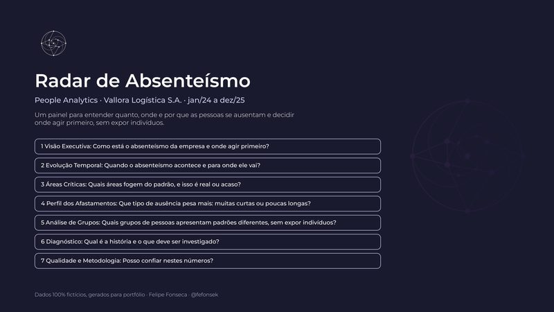

::: {.hero .container-lg}
# Felipe Fonseca

[[Estadístico ·]{.titulo-parte} [datos que impulsan decisiones]{.titulo-parte}]{.hero-titulo}

[Ayudo a empresas a crecer con procesos mejores y números confiables, y enseño a gerentes a hacer lo mismo.]{.hero-frase}

::: botoes
[Quiero conversar](https://wa.me/5537984129390?text=Hola+Felipe+vine+por+el+sitio+y+quiero+conversar+sobre+los+numeros+de+mi+empresa){.btn .btn-primary}
[Conocer la mentoría](#mentoria){.btn .btn-outline-primary}
:::
:::

::: {.secao .container-lg}
## Sobre mí

Soy estadístico por la UFOP y estudiante de maestría en Administración en el IFMG. Tengo más de cinco años de experiencia en el mercado, en las áreas de tecnología, gestión y ventas, y trabajé como analista de datos construyendo tableros en Power BI y organizando indicadores de gestión. Hoy ayudo a empresas de cualquier lugar, de forma presencial o a distancia, a transformar procesos y hojas de cálculo dispersas en números confiables, y números confiables en mejores decisiones.
:::

::: {.secao .container-lg}
## Cómo puedo ayudar

::: {.grade .grade-ofertas}
::: {.cartao .cartao-oferta}
### Proyectos a medida

[Lo hago contigo.]{.cartao-lema}

Diagnóstico, organización de los datos, indicadores, tableros en Power BI y auditoría de pagos y beneficios. Para quien necesita resultados rápidos y no tiene tiempo ni equipo para hacerlo solo.

[Conversar 30 minutos](https://wa.me/5537984129390?text=Hola+Felipe+quiero+agendar+una+conversacion+de+30+minutos){.btn .btn-primary}
:::

::: {.cartao .cartao-oferta #mentoria}
[Lista de espera]{.etiqueta}

### Mentoría en grupo

[Te enseño a resolverlo.]{.cartao-lema}

Encuentros en grupo para gerentes y dueños de empresas que quieren entender sus propios números, armar sus indicadores y decidir con más seguridad. Se está formando el primer grupo.

[Entrar en la lista de espera](https://wa.me/5537984129390?text=Hola+Felipe+quiero+saber+del+proximo+grupo+de+la+mentoria){.btn .btn-primary}
:::
:::

[Ver todos los servicios](servicios.qmd){.mais}
:::

::: {.secao .container-lg}
## Proyecto destacado

::: destaque-projeto
[{fig-alt="Portada del tablero Radar de Ausentismo"}](proyectos/radar-ausentismo/index.qmd)

::: {}
[Proyecto · Power BI]{.etiqueta}

### Radar de Ausentismo

La tasa de ausentismo de una empresa se mantuvo en 3,77% durante dos años, y la dirección concluyó que el tema estaba bajo control. Este tablero en Power BI muestra que esa estabilidad era solo aritmética: un empeoramiento concentrado en dos equipos del turno nocturno quedaba oculto por mejoras en otros frentes.

Empresa y datos ficticios; método, modelado y análisis reales.

[Ver el proyecto](proyectos/radar-ausentismo/index.qmd){.btn .btn-primary}
:::
:::
:::
