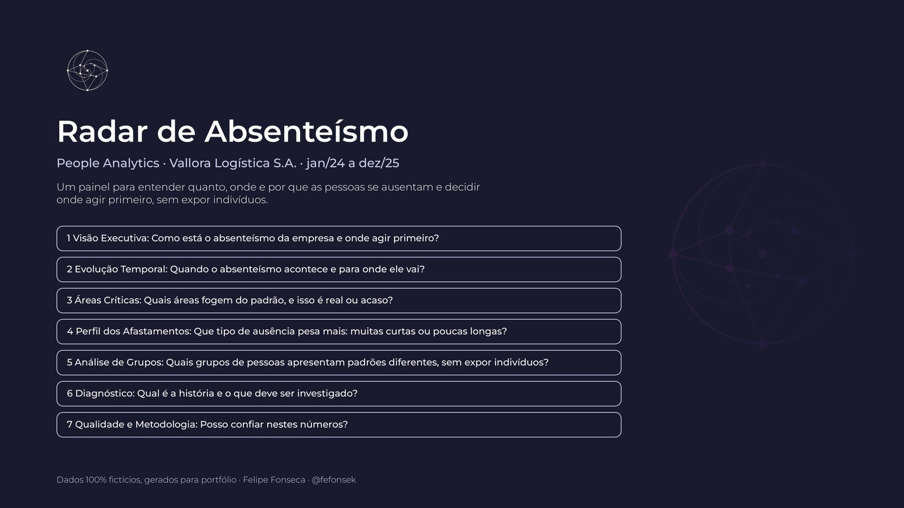

::: aviso-dados
**Datos ficticios.** La empresa (Vallora Logística S.A.), sus unidades, líderes y colaboradores no existen. Construí la base desde cero, en Python, para reproducir problemas que aparecen en bases reales. Ningún número de esta página describe a una organización real.
:::

[Las capturas del tablero están en portugués, el idioma original del proyecto.]{.nota-idioma}

::: {.content-visible when-meta="mostrar-video"}
::: video-marcador
[VÍDEO AQUI]
:::
:::

## El problema

Un operador logístico con cuatro centros de distribución y unas 1.250 personas seguía el ausentismo con un único número mensual. En dos años no se movió: 3,77% en 2024 y 3,77% en 2025. Para la dirección, el tema estaba bajo control.

Los gerentes de operaciones no estaban de acuerdo. Hablaban de más horas extra para cubrir faltas en el turno nocturno y de más accidentes entre personas recién contratadas. El número era correcto y la percepción también; faltaba una manera de ver las dos cosas juntas.

## Lo que mostró el tablero

- **La estabilidad era aritmética.** El fin de un brote de enfermedades infecciosas y menos ausencias de larga duración compensaron un alza de 8% en las demás ausencias de corta duración.
- **El empeoramiento tenía nombre y apellido.** En dos equipos del turno nocturno de Duque de Caxias, uno de Preparación de Pedidos y otro de Despacho (Separação e Expedição), la tasa de corta duración pasó de 3,5% a 6,5% desde abril de 2025. El resto de esa unidad y el turno nocturno de las demás unidades no cambiaron. Los dos equipos habían cambiado de supervisor semanas antes: una pista para investigar, no una conclusión.
- **La noche pesa más en toda la empresa** (razón de tasas ajustada de 1,31), y el personal recién contratado falta 1,8 veces más.
- **Pocos eventos concentran muchas horas:** el 1,6% de los eventos suma el 34% de las horas perdidas.
- **Una asociación aparente era falsa.** Los equipos grandes parecían faltar más, pero el único equipo muy grande era nocturno. Al separar por turno, el efecto desaparece.

## Galería

Haz clic en una pantalla para ampliarla.

{.capa-projeto group="telas" description="Portada" fig-alt="Portada del tablero Radar de Ausentismo"}



## Cómo se construyó

**Los datos.** Trece tablas con el formato de exportación de un ERP brasileño: registro seudonimizado de 1.826 personas, jornada programada día por día (662 mil filas) y 13,6 mil eventos de ausencia. Registrar la jornada programada de cada día es lo que permite calcular la tasa en horas y tratar bien llegadas tarde, jornadas parciales, vacaciones e ingresos a mitad de mes. También inyecté 146 defectos típicos de extracción (duplicados, fechas invertidas, claves huérfanas, escrituras distintas) para que la limpieza tuviera algo concreto que resolver.

**La limpieza.** 26 consultas en Power Query limpian y validan la base. Una página del tablero muestra qué se corrigió y cuánto, para que quien lo lea sepa si puede confiar en los números.

**El modelo.** Esquema en estrella con tres tablas de hechos de distinta granularidad (jornada, ausencia por día y evento) y 97 medidas DAX, organizadas por tema.

**La estadística.** Tres decisiones definen el proyecto:

1. *Descomponer antes de comparar.* La tasa total siempre se separa en corta duración (hasta 15 días, la parte en la que influye el líder directo) y larga duración (ausencias que sigue salud ocupacional).
2. *Exigir evidencia antes de alarmar.* Un área solo aparece como crítica si la desviación es grande **y** estadísticamente consistente (puntaje z de la frecuencia de eventos). Un equipo de seis personas con una sola ausencia larga no dispara una alerta.
3. *Poner a prueba las asociaciones obvias.* Un modelo binomial negativo, ajustado por unidad, departamento, turno, edad, sexo, antigüedad y año, separó lo que se sostiene (turno nocturno, antigüedad, unidad) de lo que no (tamaño del equipo, sexo).

**El informe como código.** Las páginas del tablero no se armaron arrastrando visuales. Una especificación única describe cada visual (posición, campos, medidas y la pregunta que responde), y un script en Python genera a partir de ella el informe en el formato de proyecto de Power BI y la documentación. Así, documentación y tablero no se contradicen. Un script de auditoría verifica que cada medida usada exista en el modelo y que los números citados coincidan con la base.

**La privacidad como requisito.** Sin nombre, documento de identidad ni correo; motivos de salud solo agregados; grupos de menos de 10 personas suprimidos; seguridad a nivel de fila por unidad y por líder; y un aviso explícito de que el tablero no sirve para sancionar a nadie.

::: {.content-visible when-meta="mostrar-repositorio"}
[Ver el repositorio en GitHub](https://github.com/fefonsek/radar-absenteismo){.btn .btn-outline-primary}
:::

## Lo que demuestra este proyecto

- **Entender el negocio antes de abrir Power BI:** la pregunta correcta era "dónde empeoró la tasa", no "cuál es la tasa".
- **Modelado dimensional y DAX** sobre una base con distintas granularidades y reglas de cálculo que cambian el resultado.
- **Estadística aplicada a decisiones:** descomposición, pruebas de consistencia y control de factores de confusión, sin confundir asociación con causa.
- **Diseño y comunicación:** cada página responde una pregunta, con el estado siempre acompañado de una etiqueta y una paleta sobria.
- **Gobernanza y privacidad:** reglas documentadas, calidad de datos visible y protección de los grupos pequeños.

::: cta-final
## ¿Quieres este tablero con los datos de tu empresa?

La misma estructura funciona con la exportación de tu sistema de nómina o de control de asistencia. Cuéntame cómo están hoy tus datos y te digo qué se puede hacer.

[Escríbeme](../../contacto.qmd){.btn .btn-primary}
:::
