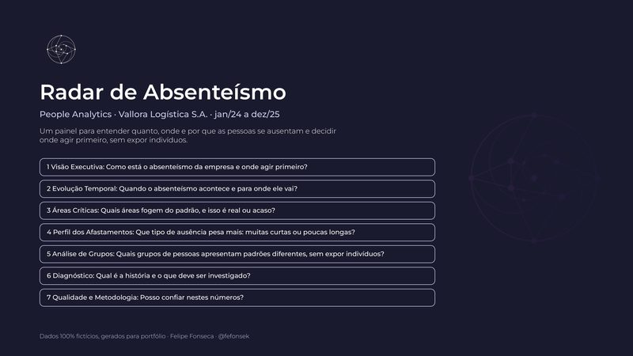

::: {.hero .container-lg}
# Felipe Fonseca

[Estatístico · dados que viram decisão]{.hero-titulo}

[Ajudo empresas a crescer com processos melhores e números confiáveis, e ensino gestores a fazer o mesmo.]{.hero-frase}

::: botoes
[Quero conversar](https://wa.me/5537984129390?text=Ola+Felipe+vim+pelo+site+e+quero+conversar+sobre+os+numeros+da+minha+empresa){.btn .btn-primary}
[Conhecer a mentoria](#mentoria){.btn .btn-outline-primary}
:::
:::

::: {.secao .container-lg}
## Sobre

Sou estatístico pela UFOP e mestrando em Administração no IFMG. Tenho mais de cinco anos de experiência no mercado, nas áreas de tecnologia, gestão e vendas, e atuei como analista de dados construindo painéis em Power BI e organizando indicadores de gestão. Hoje ajudo empresas de qualquer lugar, presencial ou a distância, a transformar processos e planilhas espalhadas em números confiáveis, e números confiáveis em decisões melhores.
:::

::: {.secao .container-lg}
## Como eu posso ajudar

::: {.grade .grade-ofertas}
::: {.cartao .cartao-oferta}
### Projetos sob medida

[Eu faço com você.]{.cartao-lema}

Diagnóstico, organização dos dados, indicadores, painéis em Power BI e auditoria de pagamentos e benefícios. Para quem precisa de resultado rápido e não tem tempo ou equipe para fazer sozinho.

[Conversar 30 minutos](https://wa.me/5537984129390?text=Ola+Felipe+quero+marcar+uma+conversa+de+30+minutos){.btn .btn-primary}
:::

::: {.cartao .cartao-oferta #mentoria}
[Lista de espera]{.etiqueta}

### Mentoria em grupo

[Eu ensino você a resolver.]{.cartao-lema}

Encontros em grupo para gestores e donos de empresa que querem entender os próprios números, montar seus indicadores e decidir com mais segurança. A primeira turma está sendo formada.

[Entrar na lista de espera](https://wa.me/5537984129390?text=Ola+Felipe+quero+saber+da+proxima+turma+da+mentoria){.btn .btn-primary}
:::
:::

[Ver todos os serviços](servicos.qmd){.mais}
:::

::: {.secao .container-lg}
## Em destaque

::: destaque-projeto
[{fig-alt="Capa do painel Radar de Absenteísmo"}](projetos/radar-absenteismo/index.qmd)

::: {}
[Projeto · Power BI]{.etiqueta}

### Radar de Absenteísmo

A taxa de absenteísmo de uma empresa ficou em 3,77% por dois anos seguidos, e a diretoria concluiu que estava tudo sob controle. Este painel em Power BI mostra que a estabilidade era só aritmética: uma piora concentrada em duas equipes do turno da noite estava escondida por uma melhora em outras frentes.

Empresa e dados fictícios; método, modelagem e análise reais.

[Ver o projeto](projetos/radar-absenteismo/index.qmd){.btn .btn-primary}
:::
:::
:::
