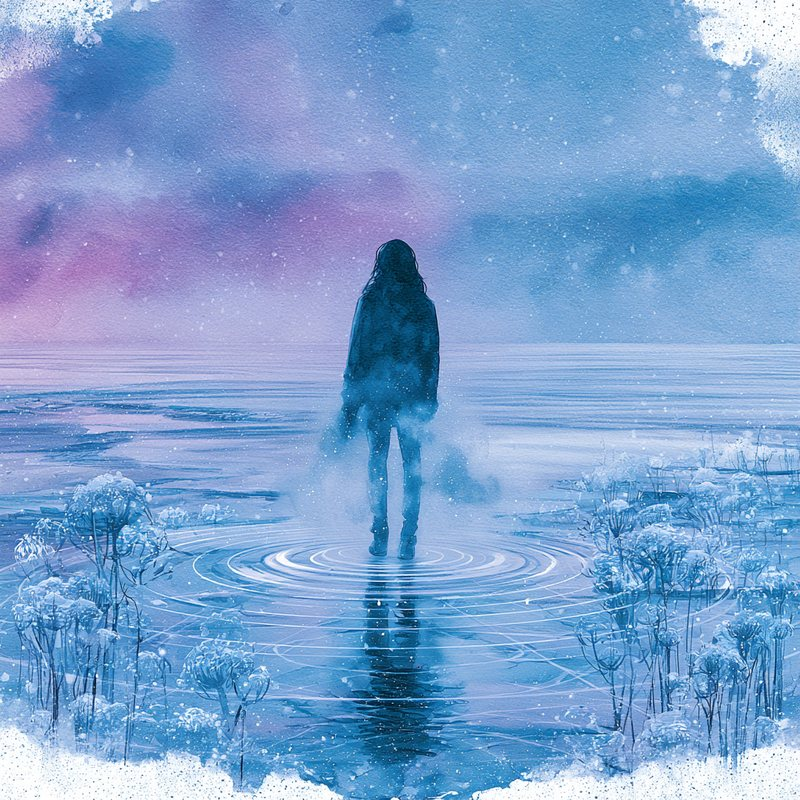

::: saline-abertura
::: {}
[Saline Astral]{.saline-rotulo}

# Decifre os sinais que vivem em você.

[Música, palavra e psicologia profunda para quem já percorreu algum caminho e ainda encontra os mesmos padrões.]{.saline-frase}
:::

{.saline-imagem fig-alt="Aquarela de uma figura de pé sobre uma planície de sal sob um céu azul e lavanda" width="800" height="800"}
:::

::: saline-secao
## Quem é Saline Astral

Saline Astral nasceu de uma pergunta: e se os padrões que aprendi a enxergar nos dados também existissem dentro de nós?

Por trás deste projeto há um estatístico e mestrando em Administração que encontrou no rigor analítico uma forma diferente de olhar para dentro. Aqui, Jung, a neurociência emocional e a arte conversam sem pressa. Não há promessa de cura nem fórmula de motivação. Há um convite para se conhecer, inclusive nas partes que você aprendeu a esconder.
:::

::: saline-secao
## Música

As canções de Saline Astral existem em português, espanhol, inglês, francês e alemão, porque o que se sente por dentro não cabe numa língua só.

[Destaque]{.saline-rotulo}

Álbum **SAL**, o primeiro da trilogia SAL, BRASA e NÉVOA.

```{=html}
<div class="saline-player">
<iframe src="https://open.spotify.com/embed/album/62Yawt9mDFj7qPiIemdoqL" title="Player do Spotify: álbum SAL, de Saline Astral" height="352" loading="lazy" allow="autoplay; clipboard-write; encrypted-media; fullscreen; picture-in-picture"></iframe>
</div>
```

[Ouça também]{.saline-rotulo}

::: saline-players
::: {}
Single "Sexto Sentido"

```{=html}
<div class="saline-player">
<iframe src="https://open.spotify.com/embed/track/66umlk8BZ7qBAROG21CnJj" title="Player do Spotify: single Sexto Sentido, de Saline Astral" height="152" loading="lazy" allow="autoplay; clipboard-write; encrypted-media; fullscreen; picture-in-picture"></iframe>
</div>
```
:::

::: {}
Último lançamento, "1026"

```{=html}
<div class="saline-player">
<iframe src="https://open.spotify.com/embed/album/248ouOmwvbeLEVeV2DX4pw" title="Player do Spotify: 1026, de Saline Astral" height="152" loading="lazy" allow="autoplay; clipboard-write; encrypted-media; fullscreen; picture-in-picture"></iframe>
</div>
```
:::
:::

[Todos os lançamentos no Spotify](https://open.spotify.com/artist/07bz9fCMgWLo8WP9tietlG)
:::

::: saline-secao
::: saline-curso
{.saline-imagem fig-alt="Aquarela de um rosto de perfil envolto por linhas de geometria sagrada" width="800" height="800"}

::: {}
[Curso]{.saline-rotulo}

## Integração com as Sombras

Treze aulas sobre a sombra, o conceito central da psicologia analítica de Carl Jung, com apoio da neurociência emocional e de práticas concretas de integração. Gratuito, no YouTube, no seu ritmo.

Integrar a sombra não é virar uma pessoa melhor. É tornar-se mais inteiro do que você já é.

[Assistir no YouTube](https://youtube.com/playlist?list=PLcpxt7S-mEbA&si=k8LiBhqYD8lvdJVk){.btn .saline-botao}
:::
:::

```{=html}
<div class="video saline-playlist">
<iframe src="https://www.youtube-nocookie.com/embed/videoseries?list=PLcpxt7S-mEbA" title="Curso Integração com as Sombras, playlist no YouTube" loading="lazy" allow="accelerometer; clipboard-write; encrypted-media; gyroscope; picture-in-picture; web-share" referrerpolicy="strict-origin-when-cross-origin" allowfullscreen></iframe>
</div>
```
:::

::: saline-secao
## Onde acompanhar

Instagram, TikTok e YouTube: @salineastral

[Instagram](https://www.instagram.com/salineastral) · [TikTok](https://www.tiktok.com/@salineastral) · [YouTube](https://www.youtube.com/@SalineAstral)
:::

::: saline-fecho
[✦ Decifre os sinais ✦]{.saline-bordao}
:::
